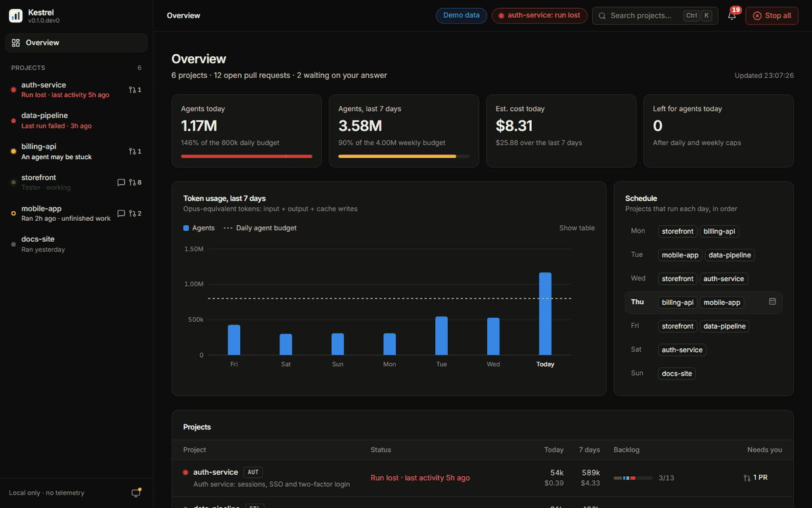
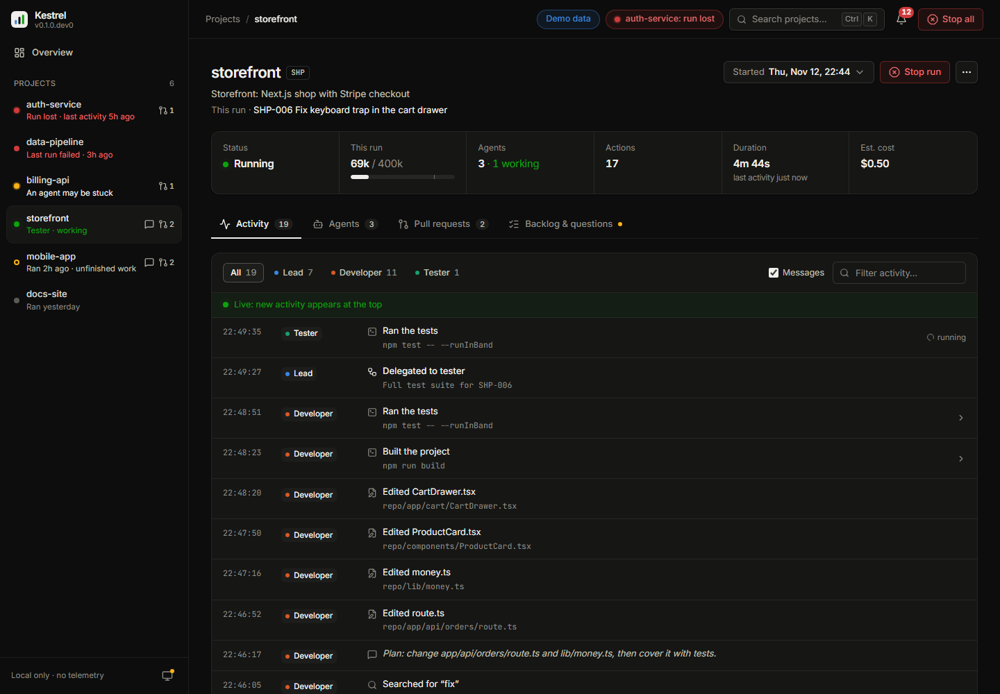
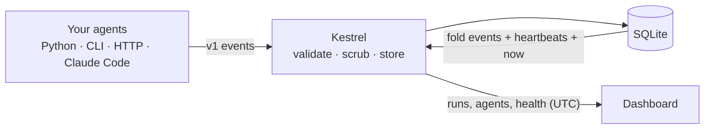

<div align="center">

# Kestrel

**Mission control for AI agents.**<br>
See what every agent is doing, what it costs, and when it gets stuck. Live, local, any framework.

[](https://github.com/abdellahBSK/kestrel/actions/workflows/ci.yml)
[](LICENSE)
[](https://pypi.org/project/kestrel-agents/)


[Quick start](#quick-start) · [Report your agents](#report-your-agents) · [Docs](docs/README.md) · [Event format](docs/events.md) · [Roadmap](specs/ROADMAP.md) · [Contributing](CONTRIBUTING.md)



</div>

---

Agents now work for minutes or hours on their own: coding agents that open pull requests overnight,
research agents, a lead delegating to a team of specialists. While they run you are blind. Is it
compiling or dead? What did it actually do? What did it cost? What is waiting for you?

**Kestrel** is a small local dashboard that answers those questions for every agent on your
machine, whatever it is built with. Agents report tiny JSON events; Kestrel shows every run live,
the tree of agents inside it, a plain-language feed of their actions, tokens and cost, and the
pull requests and questions waiting for you.

## Why Kestrel

- 🟢 **Status you can trust.** Kestrel never takes an agent's word that it's still working. Runs
  need heartbeats; silent agents decay to *idle*, then *stale*; a run that dies mid-task shows as
  **lost**, with the agents it **cut off**. No more green dots on dead processes.
- 🔌 **Works with any agent.** A [documented event format](docs/events.md), a Python client, a CLI
  and an HTTP endpoint. A first-party adapter for Claude Code; bring your own for anything else.
- 🔒 **Local and private.** Binds to 127.0.0.1, one SQLite file, secrets scrubbed before storage,
  a token on ingest, no telemetry, no third-party requests.
- 📦 **Zero dependencies.** The Python package uses the standard library only. The dashboard ships
  pre-built inside it.
- 🛑 **In control, not just informed.** Stop an agent, a run or a whole project from the
  dashboard, and set daily caps in tokens or dollars that actually halt agents.
- 💵 **Cost you can read.** Estimated dollars next to tokens for every agent, run, project and day.
- 🔔 **Told when it matters.** Alerts for stuck agents, failed or lost runs, budgets and agents
  waiting for you: on the dashboard, on your desktop, and to Slack or Discord.
- 🧭 **Built for the morning after.** Which runs failed, which agent got stuck, which PRs need a
  review, which questions your agents left you, all on one screen.



## Quick start

Try it without installing anything but [uv](https://docs.astral.sh/uv/):

```bash
uvx kestrel-agents demo        # opens http://127.0.0.1:7777
```

Or install it (Python 3.11+, no other dependencies):

```bash
pipx install kestrel-agents    # or: pip install kestrel-agents
kestrel demo
```

`kestrel demo` runs six fictional projects through every state Kestrel knows (a live run, a stuck
agent, unfinished work, a failed run, a lost run) in a throwaway folder deleted when you stop it.

Then point your own agents at it:

```bash
kestrel hook install   # every Claude Code session on this computer reports to Kestrel
kestrel watch          # the dashboard for your real runs
```

<details>
<summary><b>Docker</b></summary>

```bash
docker run --rm -p 127.0.0.1:7777:7777 ghcr.io/abdellahbsk/kestrel demo --no-browser
docker compose up      # the dashboard, with its data in the kestrel-data volume
```

The port is published on 127.0.0.1 only. Agents on the host report to it over HTTP.
</details>

<details>
<summary><b>From source</b></summary>

Node 20+ builds the dashboard once:

```bash
git clone https://github.com/abdellahBSK/kestrel && cd kestrel
python -m venv .venv && source .venv/bin/activate   # Windows: .venv\Scripts\activate
pip install -e .
(cd frontend && npm ci && npm run build)
kestrel demo
```
</details>

## Report your agents

**Claude Code and the Claude Agent SDK**: `kestrel hook install` once, or one line in your SDK
program: `ClaudeAgentOptions(hooks=kestrel.adapters.claude_agent_sdk.hooks())`. Each prompt
becomes a run, subagents become child agents, tool calls and tokens appear live.
[Details](docs/claude-code.md).

**Python**: no server needed; events go straight into the local store.

```python
from kestrel.client import Reporter

with Reporter("my-project").run("Fix the login bug") as run:  # heartbeats while open
    lead = run.agent("lead", role="lead", model="claude-opus-5-5")
    dev = run.agent("dev-1", role="developer", parent="lead", description="Implement the fix")
    dev.action("Bash", detail="npm test", summary="Ran the tests", result="42 passed")
    dev.tokens(input=1200, output=300, model="claude-sonnet-5-5")
    dev.finish()
    lead.finish()
# an exception inside the block marks the run failed, with the error
```

**Any language**: the CLI, or one HTTP request per event.

```bash
RUN=$(kestrel emit run.started --project my-project -d title="Fix the login bug")
kestrel emit agent.action --project my-project --run $RUN --agent dev-1 -d tool=Bash -d detail="npm test"
kestrel emit run.finished --project my-project --run $RUN

curl -X POST http://127.0.0.1:7777/v1/events \
  -H "Authorization: Bearer $(kestrel token)" -H "Content-Type: application/json" \
  -d '{"type":"agent.message","project":"my-project","run":"r1","agent":"lead","data":{"text":"hi"}}'
```

The [event format](docs/events.md) is twelve event types, documented in one page, and
[writing an adapter](docs/adapters.md) for your framework usually takes one file.

## How it works



Agents report facts, never status. Kestrel decides what is live from the evidence and the clock,
every time you look. Details in [the architecture](docs/architecture.md) and the
[decision records](docs/adr).

## The Claude Code runner (optional)

Kestrel also ships a scheduled runner for teams of [Claude Code](https://docs.claude.com/en/docs/claude-code)
agents: a lead delegating to developer, tester, QA, security and optimizer subagents, working on
your repositories within a daily token budget, every task on its own branch and pull request.

```bash
kestrel setup          # create the team workspaces from [teams.*] in your config
kestrel run --dry-run  # what today's scheduled run would do
kestrel status         # tokens used today and this week, budget left
```

[The runner guide](docs/runner.md) covers setup, what happens during a run, the guard's rules and
scheduling on Windows, macOS and Linux.

A guard hook blocks pushes to anything but task branches, writes outside the team folder, secret
files and outbound HTTP; enforces the budget; makes QA wait for the tests; and stops a lead from
ending a run while its agents still work. It is a strong guardrail, **not a sandbox**: review
agent changes before merging, and use a container or VM for real isolation.

## Configuration

Everything lives in one home folder: `$KESTREL_HOME`, or `~/.kestrel`. A config file is optional.
`kestrel init` writes a commented one where every value is the default, and `kestrel doctor`
checks your setup and says how to fix what isn't right.

```toml
[budget]
agents_daily = 800_000        # token budget line on the dashboard (0 = none)

[monitor]
heartbeat_timeout = 45        # silent this long → the run is lost
stale_after = 600             # an agent idle this long may be stuck

[alerts]
webhook = "https://hooks.slack.com/services/…"   # optional; desktop notifications are on by default

[projects.my-project]
title = "My project: what it is"
daily_usd = 20                # stop its agents once they cost this much today
```

## Roadmap

Kestrel is pre-1.0 and moving fast. The [roadmap](specs/ROADMAP.md) lists what it doesn't do well
yet, and which release fixes it. Next up:

- [x] Claude Code hooks adapter for any Claude Code session, and a Claude Agent SDK adapter
- [ ] Adapters for more frameworks ([ask for yours](../../issues/new?template=adapter_request.yml))
- [x] Alerts: stuck agent, failed run, budget threshold, PR waiting
- [x] Estimated cost in USD next to tokens
- [x] Stop buttons per agent and per project; budget caps that halt agents
- [x] `pipx install kestrel-agents`, `uvx kestrel-agents demo`, Docker image on GHCR
- [ ] v0.2: an OpenTelemetry bridge, adapters for the OpenAI Agents SDK, LangGraph and CrewAI,
      a faster Claude Code hook, and costs that read right on a subscription
- [ ] v0.3: alerts without the dashboard open, scheduling on every OS, a performance budget
- [ ] v0.4: team mode

Want an adapter for your framework? [Ask for it](../../issues/new?template=adapter_request.yml),
or build it: it is usually one file.

## Contributing

Kestrel is built [spec-first](specs/README.md) against a short [constitution](specs/constitution.md).
Bug fixes go straight to a PR; features start as an issue and a spec. See
[CONTRIBUTING.md](CONTRIBUTING.md) to set up a dev environment in two minutes.

## License

[MIT](LICENSE)
