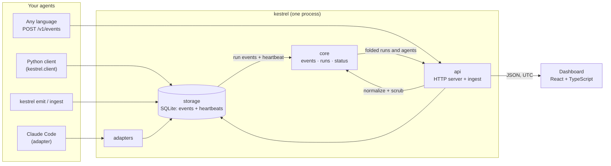

# Architecture

Kestrel is one Python process with no runtime dependencies, a SQLite file and a static web app.
Everything an agent reports is an **event**; everything the dashboard shows is computed from
events at read time.

## Layers

Dependencies point inward: `core` imports nothing else from Kestrel; `storage` depends on `core`;
everything else depends on both.

| Package | Responsibility | May import |
|---|---|---|
| `kestrel.core.events` | The v1 event contract: validation, normalization, timestamps, secret scrubbing. | stdlib |
| `kestrel.core.runs` | `fold()`: turn one run's events and heartbeat into run and agent state. | `core.status` |
| `kestrel.core.status` | Liveness rules (working, idle, stale, lost…), team health, runner heartbeats. | stdlib |
| `kestrel.storage.store` | SQLite event store: idempotent inserts, run listing, heartbeats, token sums. | `core` |
| `kestrel.adapters.*` | Convert another tool's output (Claude Code transcripts) into events. | `core`, `storage` |
| `kestrel.api.ingest` | Token management and `POST /v1/events` body parsing. | `core`, `storage` |
| `kestrel.api.server` | HTTP server: dashboard assets, JSON API, ingest endpoint, caching. | all of the above |
| `kestrel.client` | The Python SDK (`Reporter`, `Run`, `Agent`). | `core`, `api.ingest`, `storage` |
| `kestrel.cli` | The `kestrel` command. | everything |
| `kestrel.runner` | Optional scheduled runner for Claude Code teams, plus its guard hook. | `core`, `meter`, `paths` |
| `kestrel.meter` | Config loading and token metering from Claude Code logs. | `paths` |
| `kestrel.demo` | Fake projects for `kestrel demo`. | `client`, `api` |

## Data flow of one event

1. A client builds an event (`{"type": "agent.action", ...}`).
2. `core.events.normalize` validates it, converts `ts` to UTC epoch seconds (clamping the future),
   scrubs secrets from every string and returns a canonical dict with an `id`.
3. `storage.Store.add` inserts it, ignoring an `id` it already has. Heartbeat events only update
   the `heartbeats` table, so they cost one row per run, not one per beat.
4. When the dashboard asks for a project, `api.server` lists its runs, and for each one
   `core.runs.fold` replays the events in order with the latest heartbeat and the current time,
   producing the run's state and each agent's state, tokens, errors and feed.
5. Folded runs are cached by `(run, version)`, where the version changes with every new event,
   so a page load costs one cheap query per run.

## Why state is computed at read time

Liveness depends on *now*. A run that was live a minute ago is lost now if nothing arrived since.
Storing "state" would mean a background job rewriting it; computing it from events and the clock
makes the answer correct by construction. See
[ADR 0004](adr/0004-server-decides-liveness.md).

## The web app

`frontend/` is a Vite + React 19 + TypeScript app (Tailwind CSS, Radix UI, TanStack Query).
`npm run build` writes it into `src/kestrel/static/`, which the Python server serves with a strict
Content-Security-Policy. The app polls the JSON API; there are no websockets to proxy or secure.

## Security boundaries

- The server binds to `127.0.0.1` and rejects requests whose `Host` is not local, which stops
  DNS-rebinding attacks.
- State-changing dashboard buttons require a custom header and a same-origin `Origin`; browsers
  cannot send that header cross-site without a preflight the server never approves.
- `POST /v1/events` requires the bearer token in `<home>/ingest.token` (file mode 0600).
- Secrets are scrubbed in `core.events` before anything reaches the store.

## Decisions

Architecture decision records live in [`docs/adr/`](adr).
